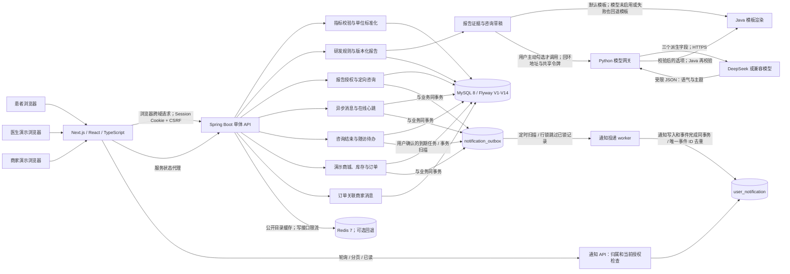

# 当前项目架构（更新至 2026-11-18）

这张图只描述当前实际接入的 Web 平台。仓库中的 NHANES/DKD 机器学习与 Electron 代码是保留的研究原型，**没有**接入新版报告或聊天业务。

用户流程：录入指标 → 生成不可变报告快照 → 对某报告授权指定医生 → 提交咨询（事务内保存咨询和首条消息）→ 医生首页显示待咨询报告及用户消息 → 医生接受后消息页显示会话 → 双方持续发消息 → 撤销授权后医生访问立即失效。用户提交时数据库已有咨询与首条消息，以免等待期间丢失；医生端聊天窗在接受后才开放。医生目录有全科、心血管内科、内分泌科三类演示账号；“在线”只是 90 秒内有页面心跳。聊天使用约 8 秒轮询，**不是** WebSocket 实时问诊。

血压报告的可选助手：Java 按报告归属和适用范围读取本次快照与更早的同条件记录。默认本地生成草稿；启用模型且用户在该次操作中勾选时，Java 只传递测量场景、是否有可比较历史、咨询重点三个派生字段。Python 不连接数据库，不接收报告原文、指标数值、日期、个人资料或用户手写内容。模型仅返回语气和问题主题选项，Python 和 Java 分别校验，最终草稿由 Java 模板渲染。模型关闭、超时或结果不合规时仍可用本地草稿；授权与发送始终是两项独立的用户操作。

商城流程：商家创建店铺、管理演示商品与库存 → 用户搜索、单店购物车、提交订单 → MySQL 事务预留库存 → 用户模拟支付、商家接单；待支付取消或超时回补库存。用户可从订单发起独立商家会话，双方围绕订单异步聊天。`shop_conversation`/`shop_message` 不复用医疗咨询表，也不关联报告；商家角色没有医生报告或医疗消息权限。商城与支付均为教学模拟，不是实际药品交易。

## 模块与边界

| 模块 | 位置 | 作用 |
|---|---|---|
| 页面 | `web/src/app` | 登录、指标、趋势、报告、医生消息、演示商城和商家订单消息 |
| API | `server/src/main/java/com/jwzz/server` | 鉴权、报告授权、咨询、商城库存订单及两套隔离消息 |
| 模型网关 | `ai_service/` | 本机可选进程，负责提供商调用和结构校验；只有它收到模型 API Key |
| 持久化 | `server/src/main/resources/db/migration` | Flyway 版本化建表；MySQL 是权限和业务状态的事实源 |
| Redis | `RequestRateLimiter`、`IndicatorCatalogController` | 限流与不含个人信息的指标目录缓存；不可用时限流退化为单实例内存计数 |
| 随访记录 | `consultation/Followup*`、`web/src/app/followups` | 不可变小结、待用户确认的提醒、到期事件、独立报告授权 |
| 站内通知 | `notification/`、`web/src/app/notifications` | 事务 Outbox、后台投递、重试记录、分页通知和独立已读；不发送邮件／短信 |
| 验收 | `scripts/verify_*.ps1`、`web/tests` | 真实 HTTP 权限/并发回归和浏览器关键流程 |

安全边界：用户只能读自己的指标与报告；医生只能读仍被授权的报告及定向会话；写接口要求登录 Cookie 与 CSRF。所有参考解读仍待临床审核，不输出诊断、处方或治疗方案。公开目录缓存不存个人数据。

启动：Windows 本机通过[一键启动脚本](local-startup.md)运行前端和 Java，使用 `-WithAi` 时才启动 Python；AI 凭据在项目目录之外由 Windows DPAPI 加密保存，前端不接收密钥或令牌。MySQL 和可选 Redis 独立运行。`compose.full.yaml` 是默认不启用外部模型的独立环境路线，使用 3001/8081 和独立 Docker 卷，不覆盖本机数据库；完整新环境启动尚未验收，见[测试报告](test-report.md)。
