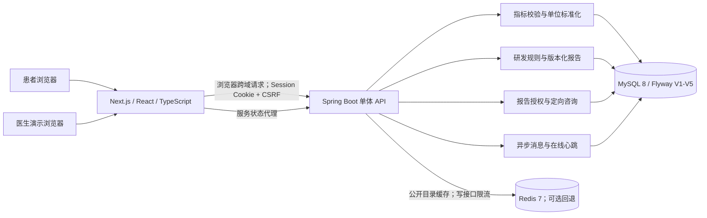

# 当前项目架构（2026-11-05）

这张图只描述当前实际接入的 Web 平台。仓库中的 NHANES/DKD 机器学习与 Electron 代码是保留的研究原型，**没有**接入新版报告或聊天业务。

用户流程：录入指标 → 生成不可变报告快照 → 对某报告授权指定医生 → 提交咨询（事务内写咨询和首条消息）→ 医生接单 → 双方持续发消息 → 撤销授权后医生访问立即失效。医生目录有全科、心血管内科、内分泌科三类演示账号；“在线”只是 90 秒内有页面心跳。聊天使用约 8 秒轮询，**不是** WebSocket 实时问诊。

## 模块与边界

| 模块 | 位置 | 作用 |
|---|---|---|
| 页面 | `web/src/app` | 登录、指标、趋势、报告、医生目录及双角色消息页 |
| API | `server/src/main/java/com/jwzz/server` | 鉴权、校验、报告、授权、咨询、消息 |
| 持久化 | `server/src/main/resources/db/migration` | Flyway 版本化建表；MySQL 是权限和业务状态的事实源 |
| Redis | `RequestRateLimiter`、`IndicatorCatalogController` | 限流与不含个人信息的指标目录缓存；不可用时限流退化为单实例内存计数 |
| 验收 | `scripts/verify_*.ps1`、`web/tests` | 真实 HTTP 权限/并发回归和浏览器关键流程 |

安全边界：用户只能读自己的指标与报告；医生只能读仍被授权的报告及定向会话；写接口要求登录 Cookie 与 CSRF。所有参考解读仍待临床审核，不输出诊断、处方或治疗方案。公开目录缓存不存个人数据。

部署：日常开发继续使用本机 MySQL/WSL Redis；`compose.full.yaml` 使用独立端口 3001/8081 和独立 Docker 卷验证新环境，不覆盖本机数据库。容器启动的实测结果见[测试报告](test-report.md)。
