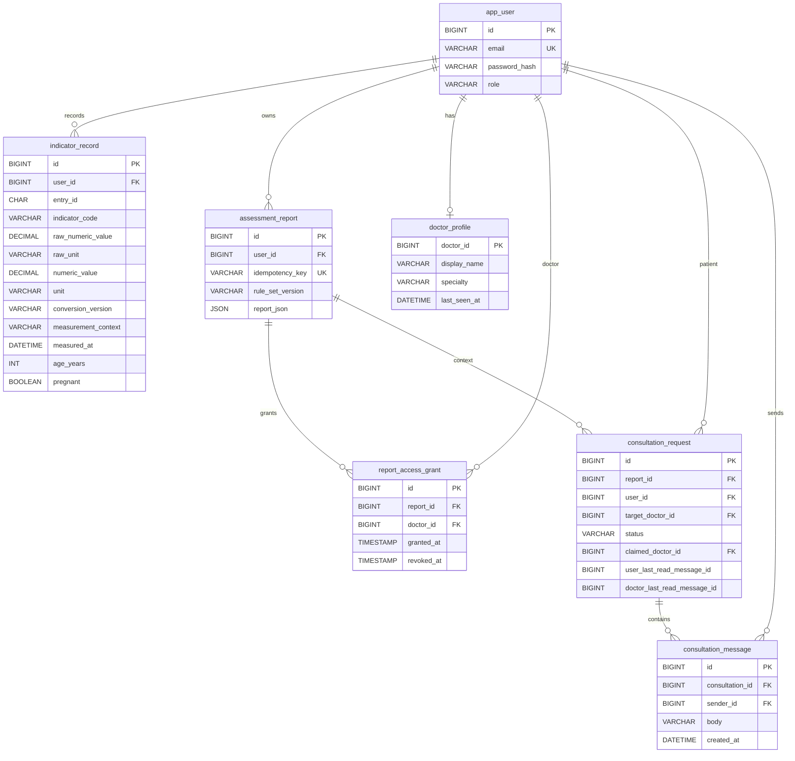

# 数据库设计（Flyway V1–V5）

MySQL `jwzz` 是当前 Web 平台的业务数据库。下图中的外键、唯一约束以迁移 SQL 为准；状态值由应用约定，尚未用数据库 `CHECK` 约束。

关键约束与索引：`app_user.email` 唯一；`assessment_report(user_id,idempotency_key)` 唯一，保证同一条录入只生成一份报告；`report_access_grant(report_id,doctor_id)` 唯一，撤销使用 `revoked_at` 软撤销、重授权恢复；`indicator_record(user_id,indicator_code,measurement_context,measured_at)` 服务同条件趋势；`consultation_message(consultation_id,id)` 服务顺序读取。

事务边界：指标一次录入的多项值在一个事务中保存；咨询创建与第一条消息在一个事务中；医生回复更新咨询状态并写消息在一个事务中。报告生成用 `READ_COMMITTED` 和唯一键处理并发重试；医生接单使用带 `status='OPEN'` 条件的 SQL 更新，8 路竞争只有一个赢家。授权读取每次检查 `revoked_at IS NULL`，不依赖缓存权限。

现有限制：`user_last_read_message_id` 和 `doctor_last_read_message_id` 是会话内的已读游标，不是外键；历史消息接口只返回前 500 条；报告列表当前没有分页，这在压测中已表现为主要扩展瓶颈。
