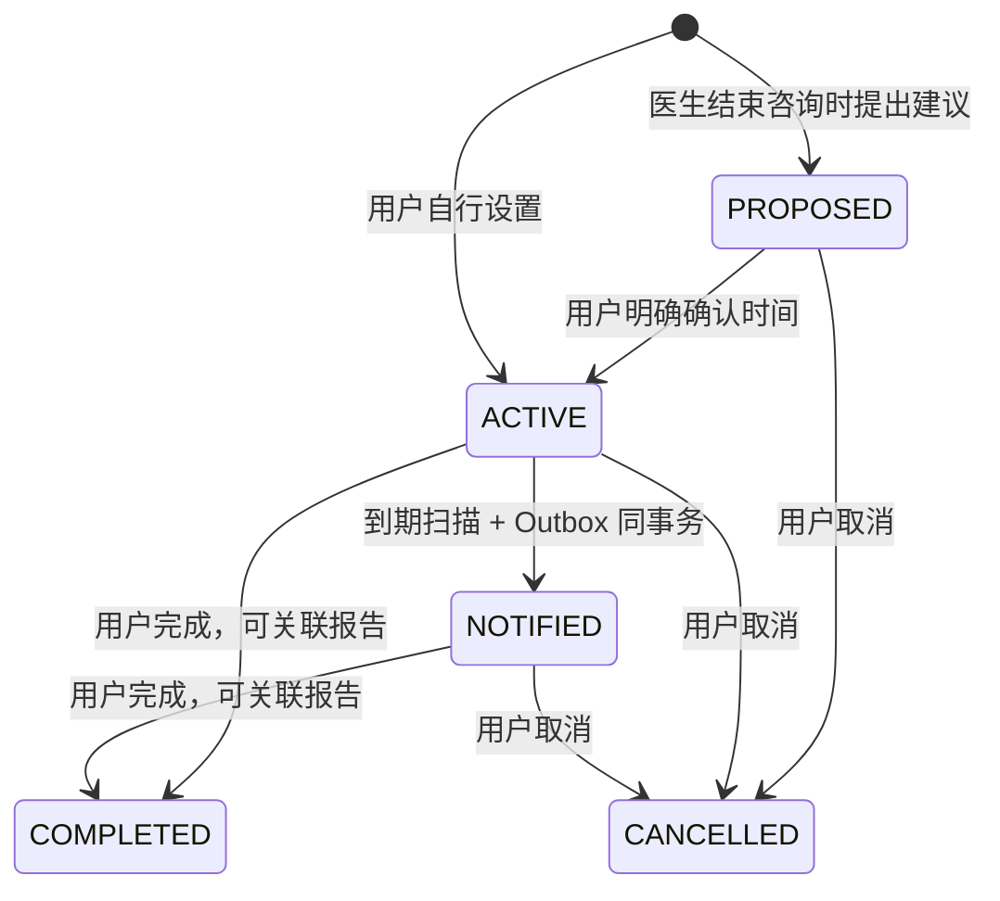

# 第三阶段：咨询结束与随访记录

日期：2026-11-18。范围：七阶段路线的第 3 阶段；不包括模拟履约退款、RAG 或新的模型调用。实现与回归完成，等待用户验收。

## 交付与使用

- 用户、医生导航增加「随访记录」。医生在已接受咨询的聊天窗点「结束咨询 / 整理随访」，填写沟通小结和可选待办建议、建议时间。
- 结束后状态为 CLOSED，两端聊天保留历史但禁止继续发送。结束不撤销报告授权，也不自动授权任何新报告。不支持重新打开或覆盖小结；需要再次沟通时另发咨询。
- 医生建议为 PROPOSED，即使建议时间已到也不触发。用户必须自行确认未来时间，才成为 ACTIVE。用户也可自己新增提醒。
- 提醒时间通过 ISO 8601 带时区的 Instant 接收，数据库以 UTC DATETIME(6) 保存，扫描使用 UTC_TIMESTAMP(6)，前端按浏览器本地时区展示。限制未来两年内，不默认填写复查周期。
- 每 5 秒扫描最多 50 条到期待办，事务内将状态改为 NOTIFIED 并写 Outbox；沿用通知投递的重试及唯一事件去重。服务离线时不会弹窗，恢复后补扫；这是站内提醒，不是系统桌面推送、短信或急症响应。
- 用户可取消未完成提醒，也可完成待办并选填一个新报告编号。不填报告也能完成。新报告必须属于本人且生成编号晚于原报告；不声称保证测量时间一定晚于原记录。完成关联不可覆盖，重复相同操作安全。
- 医生每次读取随访需原报告授权有效；关联报告还需它自身独立授权。关联未授权报告时只提示不可查看，不返回其 ID 或内容；原报告撤权后整次随访在医生端不可访问。页面约 8 秒刷新权限，报告查看接口也独立鉴权；已在撤权前阅读的内容无法撤回。
- 已结束列表按咨询 ID 倒序，每页 20，可继续加载；单次咨询最多 100 个待办。API 结束可附最多 10 个建议，当前 UI 简化为 1 个可选建议。商家无随访入口和 API 权限。

## 状态与事务



咨询行锁统一串行化结束与发消息。结束写状态、不可变小结、建议和通知事件在一个事务中。相同结束请求重试返回原结果，不同内容返回 409；用户新增提醒使用 clientKey 去重，同 key 不同内容返回 409。

提醒扫描用 FOR UPDATE SKIP LOCKED。取消、完成和扫描竞争同一待办行锁，最多一条到期事件。取消或完成后，即使事件先投递，通知查询也按待办当前状态隐藏过期提醒。原通知事件保留审计，不冒充“从未发出”。完成不表示医疗结局，仅是用户勾选待办。

## 数据库与 API

增量迁移 `V14__consultation_followups.sql`，保留 V1–V13 不变：

- consultation_closure：consultation_id 主键/外键、summary、原始 request_json（幂等比较）、closed_at。
- followup_task：咨询与创建者外键、client_key、title、UTC due_at、original_due_at、status、可选 report_id、completed_at；唯一 (consultation_id,client_key)，索引 (status,due_at,id)。
- Outbox 增加 CONSULTATION_CLOSED（resourceId=咨询 ID）和 RECORD_REMINDER_DUE（resourceId=待办 ID）。通知正文不复制小结、待办正文或报告内容。

所有写接口 Session + CSRF；角色校验之外仍查具体咨询归属和报告授权。

| 接口 | 说明 |
| --- | --- |
| GET /api/followups?beforeId=&size=20 | 自己可访问的已结束咨询，最多 100 条/页 |
| GET /api/followups/{id} | 小结、待办、逐份授权过滤后的关联报告 ID |
| POST /api/followups/{id}/close | 医生；`{summary,tasks:[{title,dueAt:null}]}` |
| POST /api/followups/{id}/tasks | 用户；`{title,dueAt:"2027-01-01T02:00:00Z",clientKey:"UUID"}` |
| POST /api/followups/{id}/tasks/{task}/confirm | 用户；`{dueAt:"2027-01-01T02:00:00Z"}` |
| POST /api/followups/{id}/tasks/{task}/cancel | 用户；`{}` |
| POST /api/followups/{id}/tasks/{task}/complete | 用户；`{reportId:123}` 或 `{}` |

## 测试与缺陷记录

测试使用本机 MySQL、真实 HTTP 和 Edge，虚构账号及报告，不调用外部 AI。后端测试只清理本次 Fixture 数据；浏览器保留虚构账号和业务样本，结束时撤回测试授权。

1. 首轮新增集成测试 5 项：1 通过、4 报错。MySQL JDBC `queryForList` 对 DATETIME 返回 LocalDateTime，但代码强转 Timestamp，关闭接口失败。修复为统一日期转换，并统一微秒精度的幂等时间比较。
2. 随后全量 54 项：53 通过、1 失败。并发发送与结束时，最终状态曾为 ANSWERED。认证读用户后已建立可重复读快照，后续虽加锁却继续用普通 SELECT 读旧状态。修复为 SELECT * FOR UPDATE 返回当前状态，并在医生回复 UPDATE 增加合法状态谓词。旧回复路径也统一加咨询行锁。
3. 新增确定性旧快照用例：先读取建立快照，再由另一连接完成结束，最后原事务尝试发送，医生和用户均须 409，数据库仍 CLOSED 且无新增消息。
4. 其他新增覆盖：4 线程重复结束、小结与事件故障回滚、6 线程到期扫描去重、取消与到期竞争、确认前不触发、重复新增/确认/完成/取消、跨用户/商家拒绝、逐份授权与撤权。
5. 浏览器新增：医生从聊天结束、用户确认与刷新恢复、完成关联、医生授权前/授权后/撤权后查看、自己设置与重复提交、取消、390px 布局；另以几秒后的真实时间运行调度与通知深链。

6. 首轮浏览器 17 项：14 通过、1 失败、2 跳过。撤权返回正确 404，但页面只显示 HTTP 404，错误提示不够清楚；改为“咨询或报告不存在，或授权已撤销”。两项旧医生用例因未加载本地演示配置跳过；第二轮加载配置重跑，不把跳过当通过。

最终后端：55 项全部通过（0 失败、0 错误、0 跳过），包含 6 项新增随访 MySQL 集成测试；默认启动 JAR 已重建。浏览器 17 项全部通过（0 失败、0 跳过），包括新增随访 2 项、消息分页 4 项、通知 3 项、用户医生 4 项、报告草稿 3 项、商家消息 1 项；类型检查通过。已检查桌面截图与窄屏宽度，聊天滚动和发送按钮保留可用。

最终机器记录：`server/target/surefire-reports/`、`.local-run/followups-e2e.json`。截图：`web/test-results/followups-随访真实流程：医生结束、用户确认、报告逐份授权和撤权/followup-desktop.png`。这是本机实跑记录，不是仅静态检查或模拟所有 API；消息分页等既有页面用例仍包含受控接口响应测试，不冒充全部真实网络故障。

## 复现命令

先停止使用同一开发库的后台应用，避免其调度器干扰故障注入测试。仅在本地开发库执行，先备份重要数据。已有 V14 后：

```powershell
# 项目根目录；PowerShell 7.4+；只用现有 Maven 缓存
. .\server\.env.local.ps1
$env:JWZZ_IT_DB_URL=$env:DB_URL
mvn -o -s "$env:USERPROFILE/.m2/settings.xml" '-Dmaven.repo.local=.maven-repository' '-Dapp.notifications.dispatch-enabled=false' '-Dapp.followups.dispatch-enabled=false' -f server/pom.xml package
# 若首次 V14 尚未应用，可先 package -DskipTests，再启动预览 -DisableJobs，应用迁移后停预览运行上面测试。
.\scripts\start_followups_preview.ps1
# 另一终端，项目 web 目录
. ..\server\.env.local.ps1
$env:TEST_WEB_URL='http://localhost:3005'
$env:TEST_API_URL='http://localhost:8085'
npx --no-install playwright test tests/followups.spec.ts tests/notifications.spec.ts tests/chat-pagination.spec.ts tests/patient-doctor-flow.spec.ts tests/report-assistant-stage2.spec.ts tests/shop-stage5.spec.ts --workers=1
npx --no-install tsc --noEmit
```

预览用 3005/8085，复用隔离 `.next-notifications` 输出和本机开发库，禁用 AI、Redis；不需要下载新依赖。保持脚本终端，Ctrl+C 停止本次子进程。不要同时启动旧通知预览（同端口）。测试报告在 `server/target/surefire-reports`、`web/test-results`；运行日志在 `.local-run/followups-preview-*`，均不提交。

## 人工验收与演示（约 5 分钟）

1. 用户生成报告并授权医生、提交咨询；医生接受，在聊天中交流一条消息。
2. 医生点击「结束咨询 / 整理随访」，填小结、一个待办建议；结束后回聊天确认不能继续发送，但可以翻阅历史。
3. 用户收到结束通知，点击进入随访。建议应为“待你确认”，未确认不会提醒。确认未来几分钟的时间，或自己添加一条提醒，刷新验证保存。
4. 等时间到，在通知中心查看记录提醒，详情应回到正确咨询。取消后提醒消失，待办保留“已取消”状态。
5. 用户录入新指标、生成新报告，在另一待办中填写新报告编号完成。医生应先看到未授权提示。用户对新报告单独授权后医生能打开，撤权后不能再打开。撤销原报告授权后医生也不能读取小结；用户仍可查看自己的记录。
6. 切换商家角色确认没有随访入口，直接请求 API 返回 403。

尚未覆盖：真实断电恢复、跨主机时钟漂移、生产负载压测、新一轮 Docker Compose 空库启动。没有新短信/邮件、自动诊疗、周期提醒或后续阶段的退款功能。不要把本阶段回归当作医疗/生产上线认证。
