# 第四阶段：模拟履约与退款

日期：2026-11-18 至 2026-11-19。七阶段路线的第 4 阶段已实现并通过回归，等待用户验收。没有接入任何真实支付、物流、退款、地址或药品交易服务。

## 已实现的范围

- 商家订单详情：模拟发货（自动生成 DEMO-SHIP-订单号）、查看收货状态、审核退款、退货验收及库存处理。
- 用户药店 → 我的订单 → 详情：确认模拟收货、填写退款原因、查看审核记录、提交模拟退货、查看退款流水。
- 首版仅整单全额退款。金额取订单的不可变 total_cents，前端不能指定退款金额。每单最多 20 次申请，只有被拒绝后可用新 clientKey 重新申请；历史申请与审核说明保留。
- 退款处理中禁止接单、发货、首次收货；已完成动作的相同重试返回当前状态，不会将订单重新推进。拒绝退款恢复申请前状态。
- 退款不是入库：未接单释放预留；接单但未发货恢复已售库存；已经发货的商品须先模拟退货、商家验收后才能退款。验收选择 RESTOCK 或 DISCARD，默认 DISCARD，不默认认定退货可再售。
- 订单详情每 8 秒同步，也可手动刷新。商家成功操作后自动刷新商品库存；申请历史区域可独立滚动。现有联系商家和订单消息继续可用。
- 新履约/退款进度在订单详情查看，本阶段未扩展通知事件或自动发送订单聊天消息，不冒充通知中心已覆盖这些新事件。

## 状态与库存设计

```mermaid
flowchart TD
  PAID[已模拟支付：库存仍预留] --> ACCEPTED[商家接单：预留转已售]
  ACCEPTED --> SHIPPED[模拟发货]
  SHIPPED --> COMPLETED[确认收货 / 订单完成]
  PAID & ACCEPTED & SHIPPED & COMPLETED --> PENDING[退款处理中]
  PENDING -->|拒绝| ORIGIN[恢复申请前状态]
  PENDING -->|未接单同意：释放预留| REFUNDED[模拟退款成功：唯一退款流水]
  PENDING -->|接单未发货同意：恢复库存| REFUNDED
  PENDING -->|已发货同意| WAIT[待用户模拟退货]
  WAIT --> RETURNED[已提交模拟退货 / 待商家验收]
  RETURNED -->|验收可再售：入库| REFUNDED
  RETURNED -->|报损：不回补| REFUNDED
```



| 退款时原订单状态 | 同意后 | 库存变化 | 最终退款时机 |
| --- | --- | --- | --- |
| PAID | 直接模拟退款 | available + 数量，reserved - 数量 | 审核同意 |
| ACCEPTED | 直接模拟退款 | available + 数量，reserved 不变 | 审核同意 |
| SHIPPED / COMPLETED | 等待退货，再验收 | 退货提交时不变；验收 RESTOCK 才加 available | 商家确认验收 |
| 任意拒绝 | 恢复 original_status | 不变 | 不退款 |

原订单行锁是串行化入口，所有新写操作先锁订单，再按 SKU 排序锁库存，统一状态谓词检查。新履约事务使用 READ_COMMITTED，让等锁后的子记录读取看到已提交的幂等记录，避免普通快照读误判。既有订单查询 JOIN 店铺，锁范围可能覆盖店铺，当前不宣称高吞吐；后续若拆锁需重新做并发验证。

退款完成时，库存变化、唯一模拟退款流水、退款申请状态和订单状态同事务提交。注入流水插入后的异常，库存和所有状态应一起回滚。唯一 order_id 和 refund_id 双约束防止同单多退；相同请求重复操作返回已有结果，冲突内容返回 409。真正资金系统需要支付渠道幂等、回调验签及对账，本阶段没有实现也不需要访问真实支付系统。

## 数据库 V15

V1–V14 原迁移保持不变，V15 新增：

- shop_shipment：order_id 主键/外键、tracking_code、shipped_at、received_at。一单一条模拟发货记录。
- shop_refund：order_id、client_key、original_status、status、reason、review_note、return_code、disposition、各阶段时间；唯一 (order_id, client_key)，索引 (order_id,id)，状态及库存处理方式 CHECK。
- shop_refund_ledger：order_id、refund_id 双唯一、amount_cents、created_at，正金额 CHECK；无银行卡、支付密钥或真实收款人字段。
- 复用 inventory_ledger，区分 REFUND_RESERVED_RELEASE、REFUND_UNSHIPPED、REFUND_RETURN_RESTOCK；报损不变更可售库存，处置结果保存在退款申请记录中。
- shop_order 原本未设状态 CHECK，本次仍由服务状态机控制，扩展 SHIPPED、COMPLETED、REFUND_PENDING、REFUNDED。发货/收货/退款完成时间分别从新表读取，不混用旧取消时间 closed_at。

## HTTP 契约

Session Cookie + CSRF；用户仅自己的订单，商家仅自己店铺订单，医生无权限。不存在或跨账号访问 404、角色/CSRF 403、非法输入 400、状态冲突 409。所有返回的 Lifecycle 包含 order、shipment、refunds、ledger。

| 路径（省略 /api） | 方法 | 请求/用途 |
| --- | --- | --- |
| /shop/orders/{id}/lifecycle | GET | 用户查询履约/退款 |
| /merchant/orders/{id}/lifecycle | GET | 商家查询履约/退款 |
| /merchant/orders/{id}/ship | POST | `{code:"DEMO-SHIP-123"}` |
| /shop/orders/{id}/receive | POST | 无正文 |
| /shop/orders/{id}/refunds | POST | `{reason:"虚构原因",clientKey:"UUID"}` |
| /merchant/orders/{id}/refunds/{refund}/review | POST | `{approve:true,note:"审核说明"}`；false 拒绝 |
| /shop/orders/{id}/refunds/{refund}/return | POST | `{code:"DEMO-RETURN-123"}` |
| /merchant/orders/{id}/refunds/{refund}/inspect | POST | `{disposition:"RESTOCK"}` 或 DISCARD |

模拟单号格式强制 DEMO- 前缀，不接收真实物流查询地址。申请、审核、发货、退货、验收的重试不得覆盖已记录内容；拒绝后的新申请须使用新的 key。取消仍仅用于未支付订单，已支付不能绕过退款审核。

## 测试记录

本机 Windows / Java 17 / MySQL 8.0.46 / Edge；只使用已有依赖，未下载新的运行时。先 package -DskipTests 启动隔离预览，成功应用 V15，然后执行真实 MySQL 测试，不把跳过测试的打包称为验收。

首轮新增后端 6 项通过，补充接单/收货竞争用例和跨商家权限断言后共 7 项：

1. 6 路相同 key 申请、8 路重复审核：一份申请、一笔退款、库存只恢复一次；分别验证 PAID 和 ACCEPTED。
2. 发货/收货重试；发货后审核同意不退款、不回库存；退货后 8 路验收只一笔退款；RESTOCK 和 DISCARD 两条分支。
3. 拒绝恢复 SHIPPED，新申请可提交；重复旧拒绝不影响新申请，旧审核结果不能覆盖。
4. 流水写入后故障注入：库存、审核说明、退款和订单状态、流水全部回滚；重试成功。
5. 跨用户、跨商家、医生角色拒绝；不同原因复用 key 冲突；其他退款编号不可操作。
6. 发货与退款竞争 8 轮：退款看到的原状态决定是否需退货，无论谁先锁都不会重复库存变化。
7. 接单与退款竞争 4 轮、收货与退款竞争 4 轮：每单仅一笔退款，结束后 available 恢复初始值、reserved 为 0。

首轮新浏览器 3 项通过：完整履约与拒绝重申请、未接单退款及 HTTP 权限/CSRF/输入校验、报损与网络失败重试。篡改请求 amountCents 为 1，退款仍按订单快照金额。验证 390px 无整页横向溢出、默认报损、刷新恢复、库存同步。

最终后端 62 项通过（0 失败、0 错误、0 跳过），其中新增履约退款集成测试 7 项。11 月 18 日完整浏览器回归因执行审批额度未能启动，11 月 19 日恢复本机预览后补跑：21 项全部通过（0 失败、0 跳过、0 重试），约 93 秒；TypeScript 类型检查通过。覆盖新增履约退款 3 项、旧订单与库存同步 1 项、随访 2 项、通知 3 项、消息分页 4 项、用户医生 4 项、报告草稿 3 项及商家消息隔离 1 项。旧支付/接单重试会在订单继续履约或退款后返回当前状态，不重新扣库存。

机器记录：`server/target/surefire-reports`、`.local-run/fulfillment-first-e2e.json`、最终 `.local-run/fulfillment-e2e.json`；截图 `web/test-results/fulfillment-履约闭环：发货收货、拒绝后再申请、退货验收入库与退款流水/refund-completed.png`。浏览器测试保留虚构订单与账号并暂停测试店铺，后端 Fixture 只删除自己创建的数据；没有删除用户订单。

## 复现与验收

使用本地开发库，先备份重要数据并停止连接同库的其他调度器，再执行。PowerShell 7.4+，项目根目录：

```powershell
. .\server\.env.local.ps1
$env:JWZZ_IT_DB_URL=$env:DB_URL
mvn -o -s "$env:USERPROFILE/.m2/settings.xml" '-Dmaven.repo.local=.maven-repository' '-Dapp.notifications.dispatch-enabled=false' '-Dapp.followups.dispatch-enabled=false' -f server/pom.xml package
.\scripts\start_fulfillment_preview.ps1
```

若首次尚未应用 V15，先 package -DskipTests、启动预览 -DisableJobs 应用迁移，再停止后执行上述完整测试。预览使用 3005/8085、本机开发库、隔离 .next-notifications，关闭 AI/Redis；与旧通知/随访预览同端口，不能同时运行。另一终端在 web 目录：

```powershell
. ..\server\.env.local.ps1
$env:TEST_WEB_URL='http://localhost:3005'
$env:TEST_API_URL='http://localhost:8085'
$env:PLAYWRIGHT_JSON_OUTPUT_NAME='../.local-run/fulfillment-e2e.json'
npx --no-install playwright test tests/fulfillment.spec.ts tests/shop-stage4.spec.ts tests/followups.spec.ts tests/notifications.spec.ts tests/chat-pagination.spec.ts tests/patient-doctor-flow.spec.ts tests/report-assistant-stage2.spec.ts tests/shop-stage5.spec.ts --workers=1 --reporter=list,json
npx --no-install tsc --noEmit
```

日常仍用原 `scripts/start_local.ps1 -WithAi` 启动，默认 JAR 随本阶段重建。

建议现场演示（约 5 分钟）：

1. 商家备货 3 件，用户购买 1 件并模拟支付，商家接受订单 → 查看明细 → 模拟发货。
2. 用户药店 → 我的订单 → 对应订单，确认模拟收货，申请退款并填写虚构原因。
3. 商家刷新订单、打开明细，同意并填审核说明。此时确认库存未增加、无退款流水。
4. 用户刷新履约状态、提交模拟退货。商家刷新，先观察默认“报损”，改为“可再售重新入库”，确认验收退款。
5. 两端查看唯一退款流水，商家核对库存从 2 回到 3。重复接口操作不产生第二笔退款、不增加第二次库存。
6. 另购一件，发货后选择报损退款，库存不回补；再测试一单 PAID 未接单的退款，预留被释放。

边界：无真实履约、无部分退款、无多包裹、无售后期限/平台仲裁/取消退款申请/自动验收、无支付渠道和金融对账；退款期间可能长期占用预留，需人工演示审核。没有新增 QPS 压测、崩溃恢复或 Docker Compose 空库验收。本阶段并发测试不是生产容量证明。
